# AUTHBC — a complete guide to the project, in plain language

*Written 2026-10-31 for Mohamed A. Farouk, first author, from a read-only study of the repository at
commit `bc7881e` (branch `p11-reviewer-revision`); paths updated 2026-11-01, after the documents were
tidied. Every number, reason and date below comes from a
file in the repository, named beside it as `path` or `path:line`, or from a commit, named by its
hash. Where a reason is not written down anywhere in the project, this guide says **"Reason not
recorded in the project"** and the question is listed in [`OPEN_ITEMS.md`](OPEN_ITEMS.md) §3
("Questions for Mohamed"). The stale documents found while writing it were corrected when the
documents were tidied on 2026-11-01; the numbers re-checked are listed in the appendix at the
end.*

**Three kinds of evidence, kept apart as the paper keeps them apart:**

| Label | Means | Example |
|---|---|---|
| **[measured]** | Done on real hardware or real bytes: a frame the code produced, a Raspberry Pi timing, a power meter reading | the 173 B frame; Ed25519 verifies in 259 µs on the Pi 4 |
| **[simulated]** | Done in the ns-3 network simulator | 124 nodes share one channel at 95 % delivery |
| **[modeled]** | Computed from a formula or an event model | the airtime capacity law; the contention model |

**Contents.**
1. The project in one page
2. Background theory, from zero
3. How we came to the problem
4. How we decided to solve it
5. Every design decision and its reason
6. How the system works, step by step
7. The five constraints
8. Every experiment
9. The evolution of the work
10. Results and conclusions
11. Limitations and open work
12. Glossary
13. Where to find things

---

## 1. The project in one page

**What we do.** A swarm of drones (UAVs, unmanned aerial vehicles) flies together. Each drone
tells its neighbours, by radio, where it is and how it is moving, 50 times a second. We want these
reports to be usable later as **evidence**: proof of where each drone was and what it claimed.
For that, every report must be signed (so nobody can forge it or deny having sent it) and chained
to the report before it (so nobody can quietly delete or reorder reports).

**The problem.** After good compression, the protection is bigger than the data. One report (a
**record**) is about 24 bytes. Its signature is 64 bytes, and its chain link is 32 bytes
(`paper/main.tex`, abstract; `results/raw/frame_components.csv`). On a shared radio channel every
byte costs airtime, and airtime decides how many drones can talk at all.

**What we built.** AUTHBC (*AUTHenticated telemetry for BlockChain-style ledgers*) is a frame
format, a sender and a receiver. One radio frame carries **four records, one signature and one
chain link**, and every frame can still be checked on its own, without any other frame
(`src/authbc/placement/wire_v2.py`, `src/authbc/placement/session_v2.py`).

**The two main results** (the paper calls them two *feasibility boundaries*):

1. **Where the frame fits** (Wi-Fi, IEEE 802.11a, 50 records per second, 100 ms deadline):
   * AUTHBC sends **43.25 B per record** against **145.77 B** when every record is signed alone:
     **70.3 % fewer bytes** [measured frames] (`results/raw/design_ladder.csv`).
   * One shared channel then holds **124 drones instead of 35** at 5 % frame loss [simulated], and
     **97.3 instead of 27.6** at 3 % frame loss [simulated] (`design_ladder.csv`;
     `results/raw/capacity_97.csv`).
2. **Where the frame does not fit** (long-range LoRaWAN): **8 of the 12** European data rates
   cannot carry even one such frame, at any batch size (`results/raw/exclusion_matrix.csv`). For
   five of them the 64 B signature alone is bigger than the 50–51 B the link allows.

**The one central insight.** *On a contended broadcast channel, the cost that binds is the
frame, not the authenticator.* Every radio frame pays about **173 µs** of fixed channel time,
whatever its length: a preamble, a waiting gap, a random backoff and a MAC header
(`src/authbc/models/phy.py:63-71`; `results/raw/phy_sweep.csv`). Sending one frame instead of
four saves three of those fixed costs. That matters more than the bytes saved. Two pieces of
evidence from the paper (§3.4 and §3.9):
* Putting four records in one frame while **keeping all four signatures** already raises the
  capacity from 35 to 76 drones (2.2×). Sharing the signature adds only another 1.6×.
* With **Falcon-512**, a post-quantum signature ten times larger (666 B), the gain is still
  **3.5×**, the same as with the 64 B Ed25519 signature.

**One rule of thumb.** Batching gains nothing unless *record rate × deadline* is above 2
(`paper/main.tex` abstract; Fig. 4, `results/raw/design_map.csv`).

**What is honest about it.** Every capacity is simulated. On hardware, contention was measured
between two radios only (`paper/main.tex` §3.5).

---

## 2. Background theory, from zero

Each idea below is explained for a capable engineer who has not studied it, with a small example.

### 2.1 Digital signatures, keys and non-repudiation

A **digital signature** is a short number that only the holder of a secret can compute for a
given message, but that anyone can check.

* The **private key** is the secret. Only the drone that owns it can **sign**.
* The **public key** is published. Anyone can use it to **verify**: to check that the signature
  belongs to this exact message and this exact signer.
* If one bit of the message changes, verification fails. The project tested this on a real frame:
  flipping any one of the 1 392 bit positions of a four-record frame makes verification fail
  (`paper/main.tex` §2.2, macro `\bitflips`).

**Non-repudiation** means the signer cannot later deny having signed. Since only the private key
can produce the signature, a valid signature is proof that its owner signed. A ledger used as
evidence needs this (`paper/main.tex` §1.1, "Stream Signing").

*Example.* Drone 7 signs "I am at (30.05, 31.23) at 12:00:00.020". Its signature is 64 bytes
(Ed25519). Drone 9, and later an auditor, verify it with drone 7's public key. If drone 7 later
claims it was elsewhere, the signed record contradicts it.

### 2.2 MAC versus signature

A **MAC** (message authentication code) is like a signature, but made with a **shared secret
key**: the same key creates and checks it. It is short and fast. For example, MAVLink 2, the
drone protocol, appends a 48-bit (6-byte) truncated SHA-256 tag plus a link identifier and a
timestamp, 13 bytes in all (`paper/main.tex` §1.1).

The weakness: **anyone who holds the key can make a valid tag for any message**. So a MAC proves
"someone in the group sent this", never "drone 7 sent this". A MAC gives no non-repudiation.

AUTHBC uses both, for different jobs:
* An **Ed25519 signature** on every frame, for evidence.
* An optional **8-byte group MAC** (truncated HMAC-SHA256 under a key every swarm member holds), to
  throw away frames from outsiders cheaply, before the expensive signature check
  (`src/authbc/placement/admission.py:9-12`).

### 2.3 Hash functions and hash chains

A **hash function** turns any input into a fixed-size fingerprint. **SHA-256** gives 32 bytes. Two
properties matter: you cannot find two inputs with the same hash, and any change to the input
changes the hash completely.

A **hash chain** links records: each record carries the hash of the record before it, called
`prev_hash` (`src/authbc/ledger/record.py`).

*Example with three records:*

```
record 0: prev_hash = 32 zero bytes (the "genesis")
record 1: prev_hash = SHA-256(record 0)
record 2: prev_hash = SHA-256(record 1)
```

If someone changes record 1, its hash changes. Record 2 then points to a hash that no longer
matches. Deleting or reordering records breaks the chain in the same way. This makes a sequence
**tamper-evident**. The idea is due to Haber and Stornetta, 1991 (`paper/refs.bib`, key
`haber1991timestamp`; paper ref. [18]).

### 2.4 Ledger

A **ledger** is an append-only record book. In AUTHBC, each drone keeps:
* its **own chain** of the records it produced, and
* the **verified records it heard** from its neighbours (`paper/main.tex` §2.1, "Ledger";
  `src/authbc/ledger/store.py`).

There is **no consensus layer**: drones do not vote on one shared history. The paper studies
only how the records are spread and authenticated (`paper/main.tex` §2.1). "Blockchain-style"
in the name refers to the hash chain, not to mining or voting. After a mission, all ledgers can be
merged and audited using only the public keys (`src/authbc/ledger/audit.py`).

### 2.5 The signature schemes: Ed25519, ECDSA, BLS and Falcon

A **signature scheme** is one specific algorithm for signing and verifying. The project uses four.
Sizes are from the paper (§2.2, §3.9); times are medians on the Raspberry Pi 4 [measured]
(`results/hw/p1_crypto.authbc-pi4a.csv`; Falcon from `results/hw/pq_speed_sig.authbc-pi4b.csv`
via the paper, §3.9).

| Scheme | Signature size | Sign | Verify | Family | Role in the project |
|---|---|---|---|---|---|
| **Ed25519** | 64 B | 88 µs | 259 µs | elliptic curve (Edwards form) | the chosen scheme |
| **ECDSA P-256** | 64 B | 136 µs | 327 µs | elliptic curve | same size, slower on the Pi |
| **BLS12-381** | 96 B as used (48 B minimal variant exists) | 2.73 ms | 8.61 ms | pairing-based | can **aggregate** many signatures into one; far too slow here |
| **Falcon-512** | 666 B (padded) | 638 µs | 88 µs | lattice-based, **post-quantum** | test: does the gain survive a huge signature? |

Why they differ:
* **Ed25519 and ECDSA** both work on elliptic curves and give 64-byte signatures. On the Pi 4,
  Ed25519 verifies faster (259 against 327 µs). The trade-off register notes that this order
  flips on x86 PCs (`docs/DECISIONS.md` (trade-off register) §4, row "Ed25519 over ECDSA").
* **BLS** signatures can be **aggregated**: many signatures combine into one. But verifying one
  needs two **pairings**, an expensive operation, so it takes milliseconds
  (`docs/revision/REVIEW_2026-10-27_FACTS.md`, S-15). The project uses the 96 B variant of the
  `blspy` library, recorded as "Mohamed's P1 decision" (`src/authbc/placement/wire.py`, module
  docstring).
* **Falcon-512** is designed to resist quantum computers. Its signature is ten times longer, yet on
  the Pi it verifies faster than Ed25519 (88 against 259 µs) (`paper/main.tex` §3.9).

### 2.6 Broadcast radio: frames, airtime and channel access

**Broadcast** means one sender, every listener in range receives. Drones broadcast their
telemetry. There is no acknowledgement (no "got it" reply) and no retransmission
(`paper/main.tex` §2.1, "Network and Traffic").

A **frame** is one radio transmission: a packet with a preamble, headers and a payload.

**Airtime** is how long the frame occupies the radio channel. It grows with length and shrinks
with the data rate.

Wi-Fi (IEEE 802.11) shares the channel with **CSMA/CA** (carrier-sense multiple access with
collision avoidance), run by the **DCF** (distributed coordination function):
1. **Carrier sense.** Listen first; send only when the channel is free.
2. **DIFS.** After the channel goes free, wait a fixed gap of **34 µs** (DCF inter-frame space).
3. **Backoff.** If the channel was busy, pick a random number of 9 µs **slots**, from 0 to 15
   (contention window W = 16). Count down only while the channel is free. Send at zero.
4. Two stations that pick the same slot send together. Their frames **collide** and are lost.

The constants (slot 9 µs, DIFS 34 µs, W = 16) are those of IEEE 802.11a, as coded in
`src/authbc/sim/dcf_unsaturated.py:36-39` and `src/authbc/models/bianchi.py:34-35`. For broadcast,
the window **never doubles** after a collision, because nobody knows a collision happened
(`paper/main.tex` §1.1, "Channel Models").

The **preamble** is a known signal at the start of each frame that lets receivers lock on. It takes
20 µs with its SIGNAL field at 802.11a (`src/authbc/models/phy.py`). A station cannot yet "hear"
a frame during the first **4 µs** of its preamble (the *preamble detection time*), so two stations
that start within 4 µs of each other both send and collide
(`src/authbc/sim/dcf_unsaturated.py:21-22`).

A **collision domain** is a group of stations that all hear one another. The main evaluation puts
all N drones in one such domain (`paper/main.tex` §2.1).

A **hidden terminal** is a station that a receiver hears but the sender does not. The sender's
carrier sense cannot protect against it. Hidden terminals appear when the swarm is spread wider
than one sensing range (`paper/main.tex` §3.9, "A Spread, Moving Swarm").

The **capture effect**: when two frames overlap but one is much stronger, the receiver may still
decode the stronger one. ns-3 keeps the strongest of frames that start together if it is at least
4 dB above the rest (`paper/main.tex` §3.9).

### 2.7 Why a frame has a fixed cost of about 173 µs, and why that matters more than bytes

Every frame pays a cost before it carries a single byte of payload. The project computes it in
`src/authbc/models/phy.py:63-71` (`fixed_cost_s`):

| Part | Time at 802.11a, 6 Mb/s |
|---|---|
| Preamble and SIGNAL field | 20 µs |
| MAC header, LLC/SNAP and checksum: 36 B, plus 22 service and tail bits, at 6 Mb/s | 51.67 µs |
| DIFS | 34 µs |
| Mean backoff: 7.5 slots × 9 µs | 67.5 µs |
| **Total** | **173.17 µs** (`results/raw/phy_sweep.csv`) |

*Worked example* (computed here with the project's own formula `bianchi.t_broadcast`, which gives
frame airtime plus DIFS; the mean backoff of 67.5 µs is added):
* Per-record signing sends a **146 B** frame for every record: 302 µs + 67.5 µs ≈ **370 µs of
  channel time per record**.
* AUTHBC sends a **173 B** frame for every four records: 338 µs + 67.5 µs ≈ 406 µs per frame, so
  **101 µs per record**.
* That is 3.6 times less channel time per record. The simulated capacity ratio is 3.5. The frame
  is 18 % longer, but there is one frame where there were four.

The fixed part is **47 %** of what a one-record frame costs the channel (`phy_sweep.csv`,
`fixed_share_of_baseline_pct`). Shrinking bytes only attacks the other 53 %. Sending fewer frames
attacks both.

### 2.8 LoRaWAN, data rates and duty cycle; 802.11a and 802.11p

**LoRaWAN** is a long-range, low-power radio standard. In Europe (the EU863-870 band) it defines
**twelve data rates**, DR0 to DR11: seven LoRa, one FSK (DR7) and four LR-FHSS
(`paper/main.tex` §3.11, citing the LoRa Alliance regional parameters RP002, ref. [47]).

Each data rate has a **maximum payload** (*M*): how many bytes one frame may carry. Slower rates
reach farther but allow less:

| Data rates | Maximum payload | Verdict for one AUTHBC frame |
|---|---|---|
| DR0–DR2, DR8, DR10 (5 rates) | 50 or 51 B | excluded: the 64 B signature alone does not fit |
| DR3, DR9, DR11 (3 rates) | 115 B | excluded: header + link + signature fill it, no room for a record |
| DR4–DR7 (4 rates) | 222 or 242 B | feasible |

(`paper/main.tex` §3.11; `results/raw/exclusion_matrix.csv`.)

The **duty cycle** limits how often a node may transmit: 1 % of the time in the relevant
European sub-band (`paper/main.tex` §3.11; `docs/DECISIONS.md` (trade-off register) §1a). The LoRa *radio chip* itself
can carry 255 B (Semtech SX1276 datasheet, ref. [48]). The limits come from the regional rules,
not from the chip.

**802.11a** is Wi-Fi on a 20 MHz channel in the 5 GHz band. The project runs it at its base rate,
6 Mb/s, "for robustness" (`docs/01_SYSTEM_MODEL_ARCHITECTURE.md:5`). **802.11p** is the vehicle
variant, on a 10 MHz channel (rates 3, 6 and 12 Mb/s in the study) (`paper/main.tex` §3.9).

### 2.9 CBOR, canonical encoding, varints and delta coding

**CBOR** (Concise Binary Object Representation, RFC 8949) is a compact binary form of JSON-like
data: maps, arrays, integers and byte strings.

**Canonical encoding** means *one* exact byte form for each value: map keys in a fixed order and
the shortest integer form. This matters because a signature covers **bytes**. If sender and
receiver could write the same record two ways, a valid record could fail its check. The project
defines it once: `canonical_bytes = cbor2.dumps(obj, canonical=True)`
(`src/authbc/ledger/record.py`). The earlier encoding paper found canonical CBOR byte-identical
across 10,000 trials (`paper/main.tex` §1.1, ref. [1]).

A **varint** (variable-length integer, LEB128) stores small numbers in fewer bytes: 7 bits per
byte, with one bit saying "more follows". **Zig-zag** maps signed numbers to unsigned ones so that
small negative numbers also stay short. In 1 byte zig-zag holds −64 … 63.

**Delta coding** sends the *difference* from the previous record instead of the full value. Drone
telemetry changes slowly between two reports 20 ms apart, so most differences are tiny.

*Example from the code* (`src/authbc/placement/wire_v2.py:27-31, 116-127`): a record is nine
numbers in a fixed order:
`ts, lat, lon, alt, vel_x, vel_y, vel_z, battery, mode`.
* A **key record** carries the absolute values. Latitude in degrees × 10⁷ is a large number and
  takes several bytes. It averages **24.0 B** in all [measured] (`frame_components.csv`).
* A **delta record** carries nine differences. At 20 or 50 ms spacing almost every difference fits
  in one byte, so a delta record is **9.0 B**, one byte per field, the floor of the format
  [measured] (`frame_components.csv`; `paper/main.tex` §2.2).
* Farther apart in time, deltas grow: 10.1 B at 0.1 s, 12.5 B at 1 s, 13.6 B at 5.5 s, 16.2 B at
  16.5 s (`frame_components.csv`, rows `kind = record, format = lean`).

### 2.10 Frame loss, verifiability, bursts, freshness and age of information

**Frame loss probability** *p*: the chance a frame does not arrive (collision or noise).

**Verifiability** *V*: the probability that a record a drone produced is received, decoded *and*
verified by a given neighbour. The target is **V ≥ 1 − ε**, with **ε = 0.05** (95 %)
(`paper/main.tex` §2.1, "Verifiability Metric").

**Burst loss**: losses that come in runs rather than one at a time. The project models it with a
**Gilbert** process (a two-state good/bad channel) (`paper/main.tex` §3.2).

**Freshness deadline** *D*max: how old a record may be when it is used. 100 ms here
(`paper/main.tex` §2.1).

**Age of information** (AoI): how old the newest information a receiver holds is. The **peak age**
is its worst value just before an update arrives. The paper's freshness bound counts the whole
filling period, which makes it a bound on peak age (`paper/main.tex` §2.3, footnote 1; Yates
et al., ref. [37]).

*Example.* At 50 records per second a record is produced every 20 ms. A frame of four records
fills in 80 ms. If that frame is lost, the receiver's newest record is one more frame period older,
so the peak age rises by 80 ms (`paper/main.tex` §3.3, "Age Under Loss").

### 2.11 ns-3, seeds, bootstrap intervals and pre-registered predictions

**ns-3** is a widely used, open-source network simulator. The project uses version 3.48 for
802.11 and its LoRaWAN module (`paper/main.tex` §2.4).

A **seed** starts the random number generator. Different seeds give different random backoffs and
send times. Each capacity point is run with **30 seeds** of 20 s each (`paper/main.tex` §2.8).

A **bootstrap confidence interval** estimates uncertainty by re-sampling the seeds with
replacement many times (10 000 here) and taking the 2.5–97.5 % range of the recomputed result
(`paper/main.tex` §2.8). The project tested its own intervals against a known truth: the plain
percentile interval covered only 92–94 % of the time, so it switched to Student-t intervals for
means and an expanded percentile bootstrap for capacities (`paper/main.tex` §2.8;
`results/raw/interval_coverage.csv`; findings F86, F101).

A **pre-registered prediction** is a prediction written down and committed to git **before** the
experiment runs, then tagged `prereg-<ID>`. A miss is reported as a miss. Every one is in
`predictions/`, indexed with its commit and outcome in `predictions/README.md`.

*Example.* S-01 predicted 27.53 and 97.89 drones at 97 % delivery before any run; ns-3 gave 27.56
and 97.30. Both fell inside the ±3 % band set in advance (`predictions/S01.md`).

### 2.12 Formal verification, Tamarin and the attacker model

**Formal verification** proves security properties mathematically, for every possible attack
within a model, instead of testing a few.

**Tamarin** is a tool (a "prover") that does this for security protocols. It explores what an
attacker can do with unboundedly many messages (`paper/main.tex` §2.1, "Formal Analysis"; ref. [34]).

The **Dolev–Yao attacker** is the standard model of a network attacker: it controls the network
completely. It can read, inject, replay, delete, delay and modify messages, but it cannot break
the cryptography and does not hold honest parties' private keys. The paper's adversary matches
this: "it reads, injects, replays, modifies, delays and drops frames … It holds no private key of
an honest UAV" (`paper/main.tex` §2.1, "Adversary"). *(The name "Dolev–Yao" does not appear in the
paper; the definition does.)*

The threats the project names:
* **Replay**: sending an old, genuine frame again. Stopped by strictly increasing sequence numbers
  (`src/authbc/ledger/store.py`).
* **Equivocation**: a sender signing two *different* records with the same sequence number (telling
  two stories). It is detected, and both frames are kept as proof
  (`src/authbc/placement/session_v2.py:91-122`).
* **Flooding**: sending many forged frames to exhaust a receiver's CPU. Stopped for outsiders by
  the group MAC, not for insiders (`paper/main.tex` §3.10).
* **Delay**: holding genuine frames back and releasing them later. Stopped by a timestamp window
  while GNSS time is available (`src/authbc/placement/freshness_rule.py`).

---
## 3. How we came to the problem

**Step 1 — the encoding work ("Pillar 1").** Before AUTHBC, the team compared message encodings for
blockchain-enabled drone networks. Canonical CBOR reduced an 18-field telemetry message from
**358 B in JSON to 130 B** (`paper/main.tex` §1, citing Farouk et al., ICEENG 2026, ref. [1],
`refs.bib` key `farouk2026encoding`). The project charter calls that published work "Pillar 1"
(`docs/00_PROJECT_CHARTER.md` §1).

**Step 2 — compression moved the cost to the cryptography.** Once the data was small, the
signature dominated. The charter, written at the start (first commit `3354ec1`, 2026-07-03), says
a fixed 64 B signature is "33 % of a CBOR record's bytes and 62 % of a delta record's"
(`docs/00_PROJECT_CHARTER.md` §1). The August plain-language account puts it as "the signature is
bigger than the thing it signs": as the message shrank from JSON to CBOR to delta-CBOR, the
cryptography's share rose from 25 % to 49 % to 59 % (`docs/archive/NARRATIVES_2026-08.md`, "The AUTHBC story" §1–2; those were July
numbers for this project's own record, not for the 18-field message of step 1).
**"Compression does not solve the problem. Compression is what creates it."** (`docs/archive/NARRATIVES_2026-08.md`, "The AUTHBC story" §2).

**Step 3 — signing and chaining every record.** A record that must be evidence needs a signature
(64 B) and a chain link (32 B). With a 24 B record, protection is about four times the data
(`paper/main.tex` abstract).

**Step 4 — the channel fills.** On a shared 802.11a channel, sending each record in its own signed
frame (*per-record signing*, 146 B per frame at 50 frames/s) lets only **35** drones share one
collision domain at 95 % delivery [simulated] (`results/raw/design_ladder.csv`, row `lean,
inline-1`). That is the problem in one number.

**The original research questions** (`docs/00_PROJECT_CHARTER.md` §2):
* **RQ1** How large is the authentication overhead after compression?
* **RQ2** Which *placement* of the signature minimises bytes while records stay verifiable under
  loss?
* **RQ3** When does an aggregatable scheme (BLS) beat a fast one (Ed25519)?
* **RQ4** What is the best end-to-end configuration, and do the models survive simulation and real
  hardware?

**What the evidence says about how the problem was first framed.** The project began as a joint
optimisation of four "axes": encoding, signature placement, signature scheme and batch size
(`docs/archive/NARRATIVES_2026-08.md`, "The AUTHBC story" §3; `src/authbc/__init__.py`). A factorial test (`make exp-ablation`) later showed
that the axes mostly do not interact: encoding is separable, and the scheme does not change bytes
(`docs/archive/NARRATIVES_2026-08.md`, "The AUTHBC story" §7). The work was then reframed around **feasibility boundaries** ("where it works,
where it cannot") rather than one optimum (`docs/archive/NARRATIVES_2026-08.md`, "The AUTHBC story" §7; `docs/00_PROJECT_CHARTER.md` §3,
items 5–6).

---

## 4. How we decided to solve it

### 4.1 The alternatives, and why each was rejected

| Alternative | What it is | Why it was not chosen | Evidence |
|---|---|---|---|
| **A smaller MAC instead of a signature** (MAVLink 2, 13 B tag) | shared-key tag on each message | no non-repudiation: anyone with the key could have made it. It also still sends a frame per record: 42.1 drones against 124.5 | `paper/main.tex` §1.1, §3.12; Table 15 (`results/raw/stream_deadline.csv`) |
| **TESLA** | a MAC whose key is revealed later | delays verification at the receiver; a disclosed key gives no non-repudiation; a frame per record (40.4 drones) | `paper/main.tex` §1.1, §3.12 |
| **Gennaro–Rohatgi chaining** | sign the first packet, hash-chain the rest | one lost packet breaks the chain; a record waits for later packets, so it never verifies within 100 ms | `paper/main.tex` §1.1, §3.12 |
| **EMSS** | several hashes per packet plus periodic signature packets | packets depend on later ones; never verifies within the deadline (34.8 drones) | `paper/main.tex` §3.12 |
| **Wong–Lam hash tree** | sign a tree over a block; each packet carries its path | each packet verifies alone and keeps non-repudiation, but pays 129 B per packet (29.0 drones) | `paper/main.tex` §3.12 |
| **Erasure-coded stream authentication** | spread hashes and signature over a block's packets | packets depend on each other; latency of one block | `paper/main.tex` §1.1 (Pannetrat & Molva, ref. [13]) |
| **Aggregate signatures** (BLS, CLAS schemes) | combine many signatures into one | they reduce the **verifier's work**, not what each signer sends (583–859 B per message in published CLAS schemes); BLS verification on the Pi serves only 10 drones per core | `paper/main.tex` §1.1, §3.6, §3.12; Table 14 |
| **Larger batches** (more records per frame) | amortise the signature further | the freshness deadline caps the batch at **4** at 50 records/s and 100 ms. The 1500 B MTU would allow 151 | `paper/main.tex` §2.3, Eq. (2) |
| **Dependent frames** (key record only every *r* frames) | save a few bytes per record | after a loss, the next frames cannot be decoded. At p = 0.05, r = 4 verifies only **0.876** of records, below 0.95; the most it could ever save is 3.5 B per record | `paper/main.tex` §3.2; Table 5 (`results/raw/e3_codec_loss.csv`) |
| **One signature split across several frames** (fragmentation) | fit a big signature on a small link | a unit spread over n frames verifies with probability (1 − p)ⁿ; with ε ≤ p only n = 1 passes | `paper/main.tex` §2.3, "Verifiability"; `docs/02_MATHEMATICAL_FOUNDATIONS.md:231` |
| **Block aggregate with fragmentation** (original placement D) | one signature over a block spanning several frames | the same (1 − p)ⁿ argument (thesis Theorem "Fragmentation is foreclosed") | `src/authbc/placement/block_agg.py`; `thesis/ch04_theory.tex` (label `thm:t3`) |

### 4.2 The chosen design

Four records, one Ed25519 signature, one chain link, and a **key record at the start of every
frame** (`paper/main.tex` §2.2, "Design Parameters"):

* **Four records**, because that is the largest batch the 100 ms deadline allows at 50 records/s
  (Eq. (2), §7).
* **One signature over the frame**, because per-record signatures inside a shared frame still cost
  64 B each (row 6 of Table 4: 93.00 B per record, against 43.25 B).
* **One chain link per frame**: the receiver recomputes the other links from the records
  themselves, so they need not travel (`wire_v2.py:38-41`).
* **A key record in every frame**, so that every frame decodes and verifies alone, and a lost frame
  costs only its own records (`paper/main.tex` §3.2).

What AUTHBC does **not** claim: "Batching several records under one signature is not new." The
contribution is the accounting: which links can carry a self-verifying frame, which constraint
caps the batch, and what the saved bytes buy in drones, with a measured implementation. "AUTHBC
introduces no new cryptographic primitive." (`paper/main.tex` §1, last paragraph of the
contributions.)

---

## 5. Every design decision and its reason

| Decision | Alternatives | Why this one | Evidence |
|---|---|---|---|
| **b = 4 records per frame** | 1, 2, 3, 5 … up to the MTU's 151 | Eq. (2): five records already fill the whole 100 ms at 50 records/s, leaving nothing for the channel. Four is the most the deadline allows | `paper/main.tex` §2.3; Table 6 (`results/raw/freshness_budget.csv`: worst case 83.8 ms); Fig. 6 (`results/raw/batch_capacity.csv`: batches 2, 3, 8 simulated) |
| **r = 1: a key record in every frame** | r = 2, 4, 8, 16 | Eq. (3): with independent loss p and target ε ≤ p, only r = 1 meets V ≥ 1 − ε. Measured with the codec in the loop: r = 4 gives 0.876 at p = 0.05 | `paper/main.tex` §3.2, Table 5; `docs/DECISIONS.md` R3; `docs/DECISIONS.md` (trade-off register) §6 ("FORCED") |
| **One signature per frame** (per-frame signing) | a signature per record inside the frame | 43.25 against 93.00 B per record; capacity 124 against 76 | Table 4, rows 6 and 8 (`design_ladder.csv`) |
| **Ed25519** | ECDSA P-256 (same 64 B), BLS (96 B), Falcon-512 (666 B) | same bytes as ECDSA but faster verification on the Pi 4 (259 against 327 µs). BLS: 8.61 ms per verification, 10 drones per core. The order flips on x86 | `docs/DECISIONS.md` (trade-off register) §4; `paper/main.tex` §3.1, §3.6; charter decision D2 (`docs/00_PROJECT_CHARTER.md` §6) |
| **One chain link per frame** (frame-linked) instead of one per record (record-linked) | 32 B link inside every record | the per-record links are redundant: a frame is signed and accepted as a unit, and the receiver recomputes them. Cost: inside a frame, order rests on the signature alone, one protection instead of two | `paper/main.tex` §2.2, "One Chain Link per Frame"; `wire_v2.py:38-41`; `docs/OPEN_ITEMS.md` G5 (confirmed by Mohamed, 2026-10-08) |
| **Integer keys** in the frame header | text keys ("src", "base_seq" …) | 29 of the 44 header bytes were key *names*. Integer keys give a 23 B header, and this alone decided whether one LoRa data rate was excluded | `docs/DECISIONS.md` (trade-off register) §4 (F44); `results/raw/frame_components.csv` |
| **Canonical CBOR** | JSON, MessagePack, plain CBOR | one exact byte form, so a signature over bytes always verifies; standard (RFC 8949); found byte-identical across 10,000 trials in the earlier work | `src/authbc/ledger/record.py` (`canonical_bytes`); `paper/main.tex` §1.1 |
| **Delta records** | full (key) records only | 9 B instead of 24 B for records 2–4: row 7 (no delta coding) is 54.50 B per record, row 8 is 43.25 B | Table 4 rows 7–8; `frame_components.csv` |
| **sender and sequence number written once per frame** | in every record | every record of a frame shares the sender and has consecutive sequence numbers; repeating them cost 10 B per record in the first format | `wire_v2.py:29-31`; `docs/DECISIONS.md` (trade-off register) §4 ("Per-record src and seq") |
| **8 B group MAC**, checked before decoding | no admission check; per-sender rate cap; cheap shape checks | an outsider's forged frame is refused in 22.5 µs instead of costing a full receive (1.08 ms); costs 3.1 % of capacity. **The choice of 8 bytes rather than another length: reason not recorded in the project** (`OPEN_ITEMS.md` Q1) | `src/authbc/placement/admission.py`; `paper/main.tex` §3.10; `docs/revision/REVISION_PLAN.md:285` |
| **Timestamp acceptance window** (Δ = 150 ms tested) | sequence numbers only | sequence numbers cannot see an attacker who *delays* frames; the signed timestamp can, at zero extra bytes. **Why 150 ms exactly: the revision plan's number, not derived in the project** (`OPEN_ITEMS.md` Q2) | `src/authbc/placement/freshness_rule.py`; `predictions/A5.md:38`; `docs/revision/REVISION_PLAN.md:240` |
| **A Rust receiver and sender** | Python only | a reviewer objection was that CPU and energy results were artifacts of an interpreted prototype. In Rust the receive path is 5.1× faster and the channel, not the CPU, binds again | `docs/revision/RESPONSE_TO_REVIEWERS.md` (Comment 8); `paper/main.tex` §3.6, §3.8; `hw/rust_receiver/` |
| **Randomised send time in ns-3** (each frame at a random instant within its period) | strictly periodic sending | strictly periodic senders freeze their relative phases for a whole run, so a few nodes collide every period while others never do; a run then samples one phase pattern. Both sources give the same mean (difference 0.0004 ± 0.0009 over 1 260 runs) | `paper/main.tex` §2.7; `docs/LOGBOOK.md` 2026-10-06 (F51, F1b); `docs/DECISIONS.md` (trade-off register) §6 |
| **50 records/s, 100 ms deadline** | 20 records/s, 250 ms | 50 Hz is the PX4 autopilot's onboard stream rate (read from its source), and the pair meets 3GPP TS 22.125 (at least 10 messages/s, at most 100 ms). The relaxed point breaks the 100 ms requirement and buys no bytes | `docs/DECISIONS.md` (trade-off register) §1; `paper/main.tex` §2.1 |
| **ε = 0.05** (target V ≥ 0.95) | other budgets | the paper takes ε = 0.05 "throughout"; the loss grid in the system model is p ∈ {0.02, 0.05, 0.10}. **Why 0.05 specifically: reason not recorded in the project** (`OPEN_ITEMS.md` Q3) | `paper/main.tex` §2.1; `docs/01_SYSTEM_MODEL_ARCHITECTURE.md:6` |
| **802.11a at 6 Mb/s** | faster rates | "base rate … for robustness". Other rates were simulated later: the gain grows at faster rates | `docs/01_SYSTEM_MODEL_ARCHITECTURE.md:5`; `paper/main.tex` §3.9, Table 10 |
| **One LoRa channel for all nodes** | three channels | broadcast needs every node on the same frequency; extra channels add no airtime, because the duty cycle is per sub-band | `docs/DECISIONS.md` (trade-off register) §1a |
| **Capacity simulated per configuration** | one load ceiling applied to all | a registered test showed the single ceiling (U = 2.435) misses by up to 23 % | `docs/LOGBOOK.md` 2026-10-06; F50; `predictions/NMAX_DIRECT_EXPECTATIONS.md` |
| **Total bytes reported, never "75 % fewer authentication bytes"** | quote 75 % | 75 % is exactly 1 − 1/b at b = 4: the definition of batching, not a finding | `docs/DECISIONS.md` (trade-off register) §2 (F13); `docs/archive/NARRATIVES_2026-08.md`, "The AUTHBC story" §6 |

---
## 6. How the system works, step by step

### 6.1 The flow

```mermaid
flowchart LR
  subgraph S[Sender drone]
    G[Telemetry source<br/>50 records/s] --> B[Batcher<br/>4 records]
    B --> C[Record coder<br/>key record + 3 delta records]
    C --> L[Ledger records<br/>prev_hash chain]
    L --> SG[Sign once<br/>Ed25519, 64 B]
    SG --> E[Encode CBOR frame<br/>173 B]
    E --> M[optional: prepend<br/>8 B group MAC]
  end
  M -->|broadcast,<br/>802.11a or LoRaWAN| R1
  subgraph R[Receiver drone]
    R1[optional: check group MAC,<br/>shape, rate, time window] --> D[Decode frame]
    D --> RB[Rebuild records,<br/>recompute prev_hash]
    RB --> V[Verify signature]
    V --> ST[Ledger store:<br/>replay, equivocation, gap]
    ST --> K[Keep frame<br/>as evidence]
  end
```



The same flow in plain text, for reading in a terminal:

```
SENDER                                              RECEIVER (each neighbour)
records (50/s) -> batch of 4 -> key + 3 deltas      [group MAC? shape? rate? time window?]
  -> chain: prev_hash = SHA-256(previous record)       -> decode -> rebuild the 4 records
  -> sign the 4 rebuilt records once (Ed25519)          -> recompute every prev_hash
  -> encode one CBOR frame (173 B)                      -> verify the one signature
  -> [optional 8 B group MAC] -> broadcast  ======>     -> store: replay? equivocation? gap?
                                                         -> keep the frame as evidence
```

### 6.2 The sender, step by step

Code: `LeanSender.frame` in `src/authbc/placement/session_v2.py:64-82`, which calls `build_B_v2`
and `encode_frame_v2` in `src/authbc/placement/wire_v2.py`.

1. **Collect four consecutive records.** Each is nine integers (§2.9). In the ledger each record
   also has a sender id `src`, a sequence number `seq` and its `prev_hash`
   (`src/authbc/ledger/record.py`).
2. **Chain them.** Record *i*'s `prev_hash` is the SHA-256 of the canonical bytes of record *i − 1*.
   The first record's `prev_hash` is the last record of the previous frame, and it becomes the
   frame's **link** field (`wire_v2.py:38-39`).
3. **Sign once.** One Ed25519 signature over the canonical CBOR of the four ledger records, each
   with its own `prev_hash`. Not over the compressed stream (`wire_v2.py:33-36, 277-285`).
4. **Code the records.** The first record as a **key record** (absolute values), the other three
   as **delta records** (differences) (`wire_v2.py:146-154`).
5. **Write the frame** as one canonical CBOR map with integer keys 0–7 (`wire_v2.py:184-192`).
   Before writing, the sender checks that the records chain and are consecutive, so that it never
   sends a frame the receiver would rebuild differently (`wire_v2.py:158-181`).
6. **Optionally wrap it** with an 8 B group MAC (`src/authbc/placement/admission.py`, `GroupMac.wrap`).
7. **Broadcast.**

### 6.3 The frame, byte by byte

The frame of the paper's operating point, with field sizes from
`results/raw/frame_components.csv` (header measured for a five-digit sender id one hour into a
50 Hz flight, as `paper/main.tex` §2.5 states). The offsets are added up here from those sizes; they
reach the measured total of 173 B.

```
offset  bytes  field (CBOR key)                 what it holds
     0      1  map header                       "a map of 8 pairs"
     1      2  0: v                             format version = 2
     3      2  1: t                             frame type = 1 (self-batch, decodes alone)
     5      4  2: src                           sender id (u16, e.g. 40000)
     9      6  3: base_seq                      sequence number of the first record (u32)
    15      2  4: n                             number of records = 4
    17     35  5: link                          key + 2-byte length + 32 B prev_hash of record 0
    52      3  6: recs (key + length prefix)
    55     24     key record                    9 varints, absolute values (24.0 B on average)
    79     27     3 delta records               9 varints each, 9 B each
   106      3  7: auth (key + length prefix)
   109     64     signature                     one Ed25519 signature
   173            end
```

* **Header H_f = 23 B** = 1 + 2 + 2 + 4 + 6 + 2 + 3 + 3 (`frame_components.csv`, rows
  `header_field, lean`; Table 2 of the paper).
* **Link L = 35 B** = 1 key byte + 2 length bytes + 32 hash bytes
  (`src/authbc/models/frame.py`, `LINK_FIELD_BYTES = 35`).
* **Records** = 24 + 3 × 9 = 51 B.
* **Signature** = 64 B.
* **Total** = 23 + 35 + 51 + 64 = **173 B**; per record **43.25 B** [measured]
  (`design_ladder.csv`: 172.999 B).

For comparison, the **record-linked format** built first (`src/authbc/placement/wire.py`) used
text keys (a 44 B header, 29 B of it key names), and put a 32 B link, the sender id and the
sequence number inside every record. Its key record is 59.9 B and its delta record 44.0 B, each
including its 32 B link (Table 2). The frame-linked format is **42 %** smaller
(`paper/main.tex` §2.2).

### 6.4 The receiver, step by step

Code: `LeanReceiver._receive` in `session_v2.py:145-179`, wrapped by `AdmissionReceiver`
(`admission.py`) and the time window (`freshness_rule.py`).

1. **Admission (optional, cheapest first)** (`admission.py:9-18`):
   * check the 8 B group MAC (refuses an outsider in 22.5 µs on the Pi, `paper/main.tex` §3.10);
   * cheap checks: length in range, eight keys present, known sender, sequence number in a window;
   * a per-sender rate cap (token bucket).
2. **Time window (optional)**: refuse a frame whose newest record is more than Δ older than the
   receiver's GNSS-based clock (`freshness_rule.py`).
3. **Decode**: parse the CBOR map, check its shape, read `src` (`wire_v2.py:235-273`).
4. **Rebuild the records**: decode the key record, then add each delta to the previous values.
   `seq = base_seq + i`. Every `prev_hash` after the first is **recomputed**, never read from the
   frame (`wire_v2.py:196-209`).
5. **Verify the one signature** over the rebuilt records (`wire_v2.py:295-301`). A frame that
   cannot be decoded cannot be verified, so nothing unverified is ever stored.
6. **Look for equivocation** across all four records, before storing any. If a different record
   is already held for the same (sender, sequence number), keep **both frames** as proof
   (`session_v2.py:158-166`).
7. **Store each record** (`src/authbc/ledger/store.py`): refuse a sequence number that is not newer
   (replay); flag a link that contradicts a held record (tampering); allow gaps (a lost frame is a
   robustness matter, not a security failure).
8. **Advance the state only now**, after verification *and* storage, so that a replayed old frame
   cannot desynchronise the receiver (`session_v2.py:173-176`).
9. **Keep the frame**: a record is evidence only together with its frame, because the signature
   covers the frame (`session_v2.py:16-21`, `frame_of`).

**What happens after a lost frame.** The next frame still decodes and verifies, because it starts
with a key record. Its link names a record the receiver does not hold: the gap shows in the
sequence numbers, and the link is stored unchecked, to be checked later by anyone who holds the
missing record, for example the post-mission audit (`paper/main.tex` §2.2;
`src/authbc/ledger/audit.py`).

---

## 7. The five constraints

The selection **minimises bytes on air** (Eq. 1), subject to **five constraints**: freshness,
verifiability, channel capacity and receiver CPU select the configuration; payload decides where
a frame can be sent at all (`paper/main.tex` §2.3). The capacity law, Eq. (6), describes the
channel constraint (§3.5 of the paper). Symbols are listed in Table 1 of the paper.

### Eq. (1) — bytes per record (the objective)

```
B(b) = ( H_f + L + g_a + s_k + (b − 1) · s_δ ) / b
```

| Symbol | Meaning | Value here |
|---|---|---|
| b | records per frame (batch size) | 4 |
| H_f | frame header | 23 B |
| L | chain-link field | 35 B |
| g_a | signature | 64 B |
| s_k | key record | 24.0 B |
| s_δ | delta record | 9.0 B |

*Worked:* B(4) = (23 + 35 + 64 + 24 + 3 × 9) / 4 = 173 / 4 = **43.25 B**. B(1) = 23 + 35 + 64 + 24 =
146 B, against 145.77 B measured. The paper says Eq. (1) is exact "to within a byte of CBOR length
prefix", and reports the measured lengths for the frame-linked format (`paper/main.tex` §2.3).

### Eq. (2) — freshness

```
D(b) = b / Λ + T_ch + t_v  ≤  D_max
```

| Symbol | Meaning | Value here |
|---|---|---|
| Λ | records per second per drone | 50 |
| b/Λ | time to fill the frame | 4/50 s = 80 ms |
| T_ch | channel access and airtime delay | 0.76 ms mean, 3.49 ms worst observed [simulated] |
| t_v | one signature verification | 0.26 ms [measured] |
| D_max | deadline | 100 ms |

*Worked:* D(4) = 80 + 3.49 + 0.26 = **83.75 ms ≤ 100 ms** (Table 6, `results/raw/freshness_budget.csv`).
With b = 5 the fill alone is 100 ms, so nothing is left for the channel: b ≤ 4 "whatever the
encoding or the scheme" (`paper/main.tex` §2.3). In general a batch of b needs Λ > b / D_max: 40
records/s here. At 20 records/s with a 100 ms deadline the batch is one and nothing is gained
(`paper/main.tex` §3.3).

### Eq. (3) — verifiability with dependent frames

```
V(r, p) = (1/r) · Σ_{j=1..r} (1 − p)^j
```

r = key-record interval (one frame in r starts with a key record); p = frame loss probability.
Frame j of a group verifies only if it and the j − 1 frames before it arrive.

*Worked at p = 0.05:*
* r = 1: V = 0.95, which meets V ≥ 0.95 exactly.
* r = 4: V = (0.95 + 0.9025 + 0.857 + 0.815) / 4 = **0.881**, which misses. Measured with the real
  codec: 0.876 (Table 5).

So with ε ≤ p only r = 1 passes (`paper/main.tex` §2.3). At the loss actually measured between
two radios, 2.3 × 10⁻⁴, even r = 16 gives V = 0.998 (`paper/main.tex` §3.2).

### Eq. (4) — receiver CPU

```
N_cpu = 1 + floor( 1 / ( (Λ/b)·k·t_v + Λ·t_h ) )
```

k = signatures per frame; t_v = one verification (Ed25519: 259.5 µs [measured],
`results/hw/p1_crypto.authbc-pi4a.csv`); t_h = one SHA-256 (2.75 µs [measured],
`docs/audits/model_provenance.md:465`). The "1 +" counts the receiver itself.

*Worked:*
* AUTHBC (b = 4, k = 1): 1 / (12.5 × 259.5 µs + 50 × 2.75 µs) = 295.75, so N_cpu = **296** drones per
  core.
* Per-record signing (b = 1, k = 1): **77**.
* BLS (t_v = 8.61 ms): **10**.

This counts cryptography only. The full Python receiver, decoding included, serves **57** per core;
the Rust receiver **290** (Table 8; `paper/main.tex` §3.6).

### Eq. (5) — payload

```
M  ≥  H_f + L + g_a + s_k
```

A self-verifying frame must hold a header, the link, the signature and one key record.

*Worked:* the smallest frame the format can produce at all (sender 0, sequence 0, every field
zero) is 16 + 35 + 64 + 9 = **124 B** [measured: produced, signed and verified]. That exceeds
115 B, so the three 115 B data rates are excluded. The signature alone (64 B) exceeds 50–51 B, so
five more are excluded (`paper/main.tex` §3.11; `exclusion_matrix.csv`).

### Eq. (6) — the airtime capacity law (the channel)

```
N_max ≈ 0.05 / ( f · (a·T + c) ),    a = 0.071 (fitted),  c = 8 µs
```

| Symbol | Meaning |
|---|---|
| f | frames per second per drone = Λ/b |
| T | time one frame holds the medium: airtime + DIFS |
| c | twice the simulator's 4 µs preamble-detection time |
| a | the one fitted constant |

*Worked* (`analysis/nmax_airtime_line.py`; T from `src/authbc/models/bianchi.py`, `t_broadcast`):
* AUTHBC: f = 12.5 frames/s, T = 338 µs → N_max ≈ 0.05 / (12.5 × (0.071 × 338 + 8) µs) =
  **125.0**, against 124.55 simulated.
* Per-record signing: f = 50, T = 302 µs → **33.96**, against 35.26 simulated.

The law was fitted to six rows of Table 4 and reproduces them within 3.8 %. It then predicted
seven new configurations within 3.4 %, with the predictions committed first
(`paper/main.tex` §3.5; F54). It is a fit at one loss level and one PHY rate; the tables always
quote simulated values, not the law.

---
## 8. Every experiment

Each entry gives: the **question**; **why** it was asked; **how** it was done (script → output);
the **result**; what it **means**; its **limits**; and its **registration**, if the prediction
was committed before the run. "Registered" means a `predictions/<ID>.md` or `predictions/`
file committed first, tagged `prereg-<ID>` for the A-items. All frame-level experiments run with
`make exp-frames` (`src/authbc/bench/frame_experiments.py`). Results are in `results/raw/` unless
another folder is named.

### 8.1 Bytes and frames

**E1 — What a frame is made of** [measured]
* *Question:* how many bytes does each field of a real frame take?
* *Why:* until October the headline was a sum of separately measured sizes, and no such frame had
  ever been produced (`docs/LOGBOOK.md` 2026-10-06; F45).
* *How:* encode real frames with `wire_v2` and measure each field →
  `results/raw/frame_components.csv`.
* *Result:* header 23 B, link 35 B, key record 24.0 B, delta 9.0 B (20/50 ms), signature 64 B →
  173 B. Record-linked: header 44 B (29 B key names).
* *Means:* every byte figure in the paper is the length of a frame the code emitted and decoded.
* *Limits:* sizes from one synthetic generator; real flight logs are checked separately (E20).

**E2 — The bytes ladder, step by step** (Table 4) [measured frames; record-linked rows estimated]
* *Question:* how much does each step save — sharing the frame, sharing the signature, delta
  coding — and where does the chain link belong?
* *How:* `design_ladder` experiment → `results/raw/design_ladder.csv`; an exhaustive search over
  placement, batch 1–12 and key-record interval.
* *Result:* frame-linked 145.77 → 93.00 (share frame) → 43.25 B (share signature, delta);
  record-linked 174.25 → 74.96 B. The search returns row 8 as the byte-minimal configuration that
  meets the freshness, verifiability and MTU constraints (`paper/main.tex` §3.1).
* *Means:* the link inside each record costs 32 B that no batch can amortise; moving it to the
  frame saves 24 B per record at b = 4.
* *Limits:* the record-linked frames with delta records were never produced; their sizes are
  estimated and marked (Table 4, footnote 1).

**E3 — Verifiability against the key-record interval** (Table 5) [measured codec, synthetic loss]
* *Question:* if only one frame in r starts with a key record, how many records still verify?
* *Why:* the July design used a key record every 16 records (`paper/main.tex` §3.2), and as
  published it verified only 0.881 (`docs/LOGBOOK.md` 2026-10-06).
* *How:* 7 200 frames per cell through the real sender, a loss process and the real receiver →
  `results/raw/e3_codec_loss.csv`.
* *Result:* at p = 0.05: r = 1 → 0.952; r = 2 → 0.921; r = 4 → 0.876; r = 16 → 0.655. Eq. (3)
  predicts each. Under Gilbert bursts of four, r = 4 gives 0.929, still below 1 − p.
* *Means:* every frame needs its own key record (r = 1).
* *Limits:* loss is generated, not measured on air.

**E4 — The loss margin** (Fig. 3; A3) [modeled + codec]
* *Question:* how far above the expected loss must the budget ε sit?
* *How:* `analysis/verifiability_margin.py` → `results/raw/verifiability_margin.csv`; five loss
  processes with the same mean.
* *Result:* with ε = 0.05 and p ≤ ε − 0.02, AUTHBC meets the target under all five, intervals
  included. At ε = 0.1, p = 0.08, the interval misses under bursts of eight and under bit errors.
* *Registration:* `predictions/A3.md` — the rule failed by its interval in 5 of 192 cells, all
  bursty (`docs/revision/STATUS.md`, A3).
* *Means:* recommendation (5): set ε at least 0.02 above the expected loss.

**E5 — Loss inside the simulator** (A3, part 2) [simulated]
* *How:* 3 000 neighbour links traced at capacity → `results/raw/verifiability_margin_trace.csv`.
* *Result:* bursts average 1.06 frames against 1.055 for independent loss: ns-3 collision loss is
  independent frame to frame. So Eq. (3) for independent loss is the right model of V at capacity.

**E6 — Length-dependent loss** (E10's bit-error rows) [modeled + codec]
* *Question:* a batch is a longer frame; at a fixed bit error rate, is it lost more often?
* *Result:* where one-record frames lose 5 %, an AUTHBC frame loses 5.7 %, and only 0.947
  [0.941, 0.953] of its records verify, below 0.95. AUTHBC meets 0.95 only while one-record
  frames lose at most 4.4 % (`paper/main.tex` §3.2).
* *Limits:* the capacities are simulated at strong, equal power, where frames are lost by
  collision, not by bit errors.

**E7 — Freshness** (Table 6) [simulated channel delay + measured verification]
* *How:* `freshness_budget` → `results/raw/freshness_budget.csv`, with the channel delay
  simulated at the heaviest load that still delivers 95 %.
* *Result:* 80 ms fill + 0.76 ms channel (mean; 3.49 ms worst) + 0.26 ms verification = 81.0 ms
  mean, **83.8 ms worst**, leaving 16.2 ms of the 100 ms. With BLS: 92.1 ms.

**E8 — Age under loss and the design map** (Fig. 4; A2) [modeled + simulated]
* *Question:* which batch do other rates and deadlines admit, and what does a lost frame do to
  the age?
* *How:* `analysis/design_map.py`, `analysis/aoi_under_loss.py` → `design_map.csv`,
  `design_map_validation.csv`, `aoi_under_loss.csv`; 3 150 ns-3 runs.
* *Result:* batching needs Λ·D_max > 2. At 15 simulated (rate, deadline) combinations, ns-3 lies
  within 1.05 % of the model. At 100 records/s and 100 ms the batch is 9 and the capacity ratio
  6.63. At p = 0.05 the mean peak age is 87.7 ms, its 99th percentile 169.8 ms; 4.7 % of updates
  exceed the deadline.
* *Registration:* `predictions/A2.md` — held; the stated cause of the age tail ("two lost
  frames") was wrong: one suffices (F90; `thesis/appB_preregistrations.tex`).

### 8.2 Channel capacity

**E9 — Direct capacity search in ns-3** (Table 4, Fig. 5) [simulated]
* *Question:* how many drones fit in one collision domain with mean delivery ≥ 95 %?
* *How:* `ns3/run_nmax_direct.py` (the `make sim-ns3-nmax` target) → `ns3_nmax_direct_runs.csv`,
  `ns3_nmax_direct.csv`; 802.11a 6 Mb/s, broadcast, equal power; 30 seeds of 20 s per point;
  bootstrap interval.
* *Result:* per-record signing 35 [35, 35]; AUTHBC 124 [124, 125]; interpolated crossings 35.3 and
  124.5. Per-run reading (95 % of runs pass): 34 and 120.
* *Registration:* `predictions/NMAX_DIRECT_EXPECTATIONS.md` — the first prediction **failed**: the older
  single load ceiling missed by −23 % and +8 % (F50; `docs/LOGBOOK.md` 2026-10-06).
* *Limits:* one collision domain, equal power, static nodes; no capacity measured on radios.

**E10 — The airtime capacity law** (Eq. 6, Fig. 6) [modeled, fitted]
* *How:* `analysis/nmax_airtime_line.py`: fitted on six cells, then seven unseen configurations
  predicted and committed before simulation (1 470 runs).
* *Result:* all seven within 3.4 % (tolerance 6 %); the old ceiling misses by up to 15 %. Five
  stream-scheme frames lie 3.5–4.2 % above the law (F54; `paper/main.tex` §3.5).
* *Limits:* one loss level, one PHY rate; frames 94–565 B. Falcon's frames fall outside that
  range, so they were checked against the contention model instead.

**E11 — The contention model** [modeled, nothing fitted]
* *Question:* *why* is capacity where it is?
* *How:* `src/authbc/sim/dcf_unsaturated.py`, an event simulation of the access rule alone, with
  two ways to lose a frame: two stations drawing the same backoff slot (a known mechanism, refs.
  [40, 41]) or starting within the 4 µs detection window (the vulnerable period of carrier
  sensing, Kleinrock & Tobagi, ref. [42]). Compared in `analysis/dcf_model_check.py` →
  `results/raw/dcf_model_vs_ns3.csv`.
* *Result:* all 18 simulated capacities within 1.2 %; six registered predictions for unsimulated
  cases (window doubled; 2 % and 10 % loss) within 1.7 %; the two 3 % loss capacities within
  0.6 % (`paper/main.tex` §3.5).

**E12 — Batches of two, three and eight** (Fig. 6) [simulated]
* *How:* three cells registered in `64322fc` before any run.
* *Result:* 66.7, 96.5 and 222.3 drones, within 1.6 % of the law and 0.8 % of the model.
  **Six predictions, six held** (F82, `docs/audits/model_provenance.md:4103`).

**E13 — Capacity at 97 % delivery** (S-01) [simulated]
* *Why:* the 124 is at 5 % loss, exactly where V meets 0.95 with no margin; the paper's own rule
  asks for 3 % (review of 2026-10-27, S-01).
* *How:* `analysis/capacity_at_97.py`; 420 ns-3 runs → `results/raw/capacity_97.csv`.
* *Result:* **27.6 and 97.3**, ratio 3.5. *Registration:* `predictions/S01.md` (`prereg-S01`) —
  both predictions and the ratio band held.

**E14 — Contention on two real radios** [measured]
* *How:* two Raspberry Pi 4 radios; prediction registered first
  (`predictions/CONTENTION_HW_EXPECTATIONS.md`, plus `…_SATURATED_…` and `…_FRAMEBURST_…`);
  results `results/hw/channel/`.
* *Result:* one transmitter alone loses 4 frames in 17 600 (p = 2.3 × 10⁻⁴). Both saturated:
  12.4 % lost, model 11.8 % (registered, held). Below saturation the radios lose 1.13, 0.79 and
  0.56 times the model as the medium fills from half to 85 %; the registered prediction held at
  two loads and **failed** at the third. A follow-up that turned off frame bursting **failed all
  four** of its predictions (F73–F76; `paper/main.tex` §3.5).
* *Means:* the access rule holds at saturation on hardware; below saturation the cause of the
  shortfall "is not established". G27 (2026-11-03, F115) tested five rules for how the radio sends
  its own queued frames, each set from the single sender's spacing. None fits both the saturated
  runs and the 36 windows, so the radio's own-queue handling is no longer "the candidate left
  standing" (`predictions/G27.md`). Found on the way: the contention model let a station collide
  with itself, which never moved a capacity (F114).
* *Limits:* two radios only; **no capacity was measured**.

**E15 — The broadcast model against the simulator** [modeled vs simulated]
* *Result:* Ma & Chen's broadcast model matches saturated ns-3 runs within ±0.51 % over N = 5–50,
  30 seeds (`paper/main.tex` §3.5; `results/raw/ns3_matrix.csv`).

### 8.3 Robustness

**E16 — Unequal power and capture** [simulated]
* *Result:* in a 15 m disc 39.6 and 140.4 drones; at 100 m 39.4 and 139.3. The equal-power
  capacities are conservative by 12–13 %; the ratio stays 3.5. *Registration:* four crossings
  (`db0bca1`) — all four held (F85).
* *Limits:* both discs keep every pair in range: no hidden stations here.

**E17 — A spread and moving swarm** (Fig. 7; A1, A1-motion) [simulated]
* *How:* `analysis/spatial_capacity.py`, `ns3/authbc-spatial.cc`, `ns3/authbc-spatial-mobile.cc`;
  discs of 100 m–1 km, log-distance loss, Nakagami fading, capture; 4 230 + 900 runs →
  `spatial_capacity.csv`, `spatial_motion.csv`, `spatial_dref.csv`.
* *Result:* the ratio stays 3.46–3.63. At 1 km, 11 % of the interferers cannot hear the sender;
  neighbours within reach (within 215 m) fall to 8.7 (AUTHBC) and 2.5 (per-record signing). Motion
  at up to 15 m/s changes delivery by at most 0.0005.
* *Registration:* `predictions/A1*.md` — the bracket for the neighbour count, 10–40, **missed**
  (8.7) (`docs/revision/STATUS.md`).
* *Limits:* no Doppler, no time-correlated fading.

**E18 — Choosing the batch at run time** (Fig. 8; A4, A4b) [simulated]
* *Result:* the registered controller (margin 0.01) met the target in only 75 % of one-second
  windows and failed at 76 drones. A second registered controller (margin 0.02): 93 %, failing at
  116; fixed b = 4: 99 %, 127. It saves 21 ms of peak age. **A4 failed as built; A4b was
  registered rather than A4 being tuned** (F102).
* *Means:* run-time batching buys freshness, not capacity.

**E19 — Other PHY rates** (Table 10; A11) [simulated]
* *Result:* AUTHBC serves 3.39–3.80 times per-record signing on six 802.11a/p settings, more at
  faster rates; the model is within 1.5 %, except 2.9–4.6 % optimistic at the fastest rate of each
  width. The registered span 1.7–4.3 **failed** (`docs/revision/STATUS.md`, A11).

**E20 — Real telemetry** [measured]
* *Flight logs:* twelve public PX4 logs (29 092 records), chosen by a rule fixed before opening
  any (`predictions/PX4_LOGS_EXPECTATIONS.md`; `results/raw/px4_log_sizes.csv`). At 0.2 s spacing, real
  deltas average 11.1 B against 10.8 B synthetic; AUTHBC saves 69.1 % (68.2 % worst) against
  69.4 % synthetic. The key-record prediction missed by 0.02 B (F52).
* *Simulated flights:* PX4 software-in-the-loop at 20 ms → `px4_sitl_sizes.csv`: every delta
  9.0 B, key 20.9 B, 42.47 B per record; the 50 Hz stream holds 20.0 ± 0.4 ms.
* *Airframes* (A9, A9-fast; Table 11): 30 flights; 9/15/25 fields save 70.1/67.2/63.3 % and give
  ratios 3.51/3.31/3.04. The registered key-record and fixed-wing delta sizes **missed**.
* *Means:* the generator is representative within about one percentage point; the gain is set by
  the number of frames, not the record size.

**E21 — A post-quantum signature** (A15) [simulated + measured]
* *How:* `analysis/pq_capacity.py`, `analysis/pq_timing.py` → `pq_capacity.csv`,
  `results/hw/pq_speed_sig.authbc-pi4b.csv`.
* *Result:* Falcon-512 (666 B) fits a frame; 12.4 against 43.5 drones, ratio 3.5. The registered
  "the ratio will be larger" **failed**. On the Pi: sign 638 µs, verify 88 µs.

### 8.4 CPU and energy

**E22 — Cryptographic timing** [measured]
* *How:* `make bench-micro` (`src/authbc/bench/micro.py`) on the Pi 4 →
  `results/hw/p1_crypto.authbc-pi4a.csv`; medians of 10 000 operations.
* *Result:* Ed25519 88/259 µs; ECDSA 136/327 µs; BLS 2.73/8.61 ms; SHA-256 2.75 µs.

**E23 — The Python receiver on the board** [measured]
* *Result:* 1.43 ms per four-record frame, 5.5 times its verification; 57 drones per core. On one
  to four cores at once: 56, 106, 150 and 187 drones, so 124 drones need three cores. The
  registered scaling ranges held for one and two cores and **failed** (low) for three and four
  (F84, `docs/audits/model_provenance.md:4192`).

**E24 — Rust receiver and deferred verification** (Table 8; A8, A13) [measured]
* *How:* `hw/rust_receiver/`; `analysis/compiled_receiver_bench.py` →
  `results/hw/compiled_receiver.authbc-pi4b.csv`; byte identity with Python on 10 000 frames
  (`analysis/rust_identity.py`).
* *Result:* 277 µs per frame (5.1× faster), 290 drones per core by Eq. (4); 643 with batches of
  64; deferred batch verification 629. A record is evidence within 191 ms by Eq. (2)'s convention
  (171 ms counting the fill wait as (b − 1)/Λ, as the registration did: `predictions/A13.md:50`).

**E25 — Sender energy** (Table 9) [measured]
* *How:* an INA219 sensor on the supply rail, five repetitions, idle power subtracted
  (`hw/validate_energy_e2e.py`; `results/raw/energy_runs.csv`, `energy_runs_2026-10-22.csv`).
* *Result:* record-linked 118.8 → 58.4 µJ per record with batching; frame-linked Python 273.1 →
  155.4; frame-linked Rust 60.7 → **17.1 µJ**. In Python the frame-linked sender costs more energy
  than the record-linked one, because of its slower codec in this prototype; in Rust the order
  follows the bytes.
* *Limits:* only the sender is metered; the sensor was never checked against a reference load
  (waived by Mohamed, 2026-10-22, `docs/OPEN_ITEMS.md` G22).

**E26 — Certificates** [modeled]
* *Result:* charging a 162 B certificate every fifth frame (38.8 B per frame): 184.57 against
  52.95 B per record. Charging one per 500 ms at any frame rate: 159.93 against 51.41 B
  (`paper/main.tex` §3.7). Both columns are upper bounds, since implicit certificates are smaller.

### 8.5 Security

**E27 — Formal proofs in Tamarin** (A6) [proof]
* *How:* `formal/*.spthy`, `formal/prove_each.sh`.
* *Result:* origin and integrity, replay, injective agreement, equivocation, gap detection
  (`formal/authbc_counters.spthy`) and continuity are proven; delayed frames: an attack without
  the window, refused with it (`formal/authbc_time.spthy`). One model with everything
  (`formal/authbc_full.spthy`) did not terminate.
* *Registration:* `predictions/A6.md` — the registered model settled 3 of 9 lemmas; 15 of 19
  predicted verdicts missed. Two of the three successful models were made after registration
  (`docs/revision/STATUS.md`, A6; `thesis/appB_preregistrations.tex`).
* *Limits:* the three models are not composed; canonical encoding is assumed injective.

**E28 — The timestamp acceptance window** (A5) [simulated clocks, real frames]
* *How:* `analysis/replay_window.py` → `results/raw/replay_window.csv`; 72 000 honest frames per
  setting.
* *Result:* with Δ = 150 ms no honest frame was refused at clock errors up to 10 ms, and every
  frame held back by 250 ms or more was refused. Without GNSS, clocks drift apart by 144 ms per
  hour; a 250 ms window holds for 75 minutes (1 of 72 000 refused), and at 90 minutes 1.6 % are
  refused. The plan's "about two hours" **failed**, as the finer registered prediction said it
  would (`predictions/A5.md`).

**E29 — Flooding** (Fig. 9; A7) [measured on the Pi]
* *How:* `analysis/flood_cost.py`, `src/authbc/placement/admission.py` →
  `results/hw/flood_cost.authbc-pi4b.csv`, `flood_udp.authbc-pi4b.csv`; 41 senders on one core,
  one core's share of 124 drones.
* *Result:* a forged frame costs 1.08 ms against 1.44 ms for an honest one; 247 forged frames per
  second break delivery. The group MAC refuses an outsider in 22.5 µs: at 3 000 forged frames/s
  delivery stays 0.984. An insider holding the key breaks it from 129/s behind the MAC and 123/s
  behind the rate cap. The MAC costs 3.1 % of capacity. The registered rates **missed** (928 per
  second per core, not 700; `docs/revision/STATUS.md`, A7).

**E30 — The post-mission ledger audit** (A16) [measured]
* *How:* `src/authbc/ledger/audit.py`, `analysis/ledger_audit.py` → `ledger_audit.csv`.
* *Result:* three drones, one flight hour, 391 495 frames (135 000 sent + 256 495 verified copies
  kept); a planted equivocation and a planted forgery both found, no false finding, in 6.4
  minutes of one core.

**E31 — Bit flips** [measured]: flipping any one of the 1 392 bit positions of a four-record frame
makes verification fail (`paper/main.tex` §2.2).

### 8.6 LoRaWAN

**E32 — The exclusion matrix** (Fig. 10, Table 13) [arithmetic on a measured frame]
* *How:* `exclusion_matrix` → `results/raw/exclusion_matrix.csv`.
* *Result:* 8 of 12 data rates excluded: 5 by the signature alone, 3 by header + link + signature
  (124 B floor > 115 B). What each relaxation buys (Table 13): sending no link frees the 115 B
  rates; a 48 B BLS signature fits 51 B but no frame of this telemetry fits 115 B (118 B); a 13 B
  MAC fits the 115 B rates.
* *Scope:* five conditions (`paper/main.tex` §3.11, "Scope").

**E33 — Capacity on the feasible rates** [simulated + external model]
* *How:* ns-3 LoRaWAN module; one channel, one demodulator, no capture
  (`results/raw/lora_capacity.csv`, `lora_budget.csv`).
* *Result:* 218 B every 36.4 s: 3 drones at mean V ≥ 0.95 (30 seeds, interval [2, 3]; 1 if 95 %
  of runs must pass). The closed-form model of Haxhibeqiri et al. (ref. [30]) gives 4. About
  0.5 records/s in all, against some 6 200 for AUTHBC on 802.11.

### 8.7 Comparison with published schemes

**E34 — Stream-signing schemes** (Table 15; A10) [simulated]
* *How:* `src/authbc/placement/stream_schemes.py`, `analysis/stream_deadline.py`,
  `ns3/authbc-links.cc` → `stream_deadline.csv`; 1 860 runs.
* *Result:* every scheme sends a frame per record (50 frames/s): MAVLink 42.1, TESLA 40.4,
  Gennaro–Rohatgi 39.4, EMSS 34.8, Wong–Lam 29.0 drones; AUTHBC 124.5. Within 100 ms only MAVLink,
  Wong–Lam and TESLA with a short disclosure delay reach 95 % (F99).

**E35 — Aggregate-signature schemes** (Table 14) [published numbers]
* *Result:* 583–859 B per message as reported by Li et al. (ref. [7]), against 52.95 B per record
  for AUTHBC with certificates. Not a ranking: those schemes give conditional privacy, which AUTHBC
  does not (`paper/main.tex` §3.12).

**E36 — Other broadcast systems** (Table 17; A17) [modeled]
* *How:* `analysis/other_links.py` → `other_links.csv`.
* *Result:* ADS-B and Bluetooth 4 Remote ID cannot carry a signature at all; V2X CAM at 10 Hz
  admits no frame at 100 ms (`paper/main.tex` §4.2).

### 8.8 Method checks

**E37 — Do the confidence intervals cover?** (H2) [simulated truth]
* *Result:* the plain percentile bootstrap covered 92–94 %; Student-t for means and an expanded
  percentile bootstrap for capacities cover 94–95 % (`results/raw/interval_coverage.csv`; F86,
  F101).

**E38 — The traffic source** [simulated]
* *Result:* randomised and strictly periodic send times give the same mean (0.0004 ± 0.0009 over 14
  points and 1 260 runs); the periodic source varies 6–23 times more between runs
  (`paper/main.tex` §2.7; F51, F61).

---
## 9. The evolution of the work

Built from `git log` (326 commits, 2026-07-03 to 2026-10-31), the phase tags `p0-done` … `p8-done`,
and the dated entries of `docs/LOGBOOK.md`.

| Date | What changed (commit) | Why |
|---|---|---|
| 2026-07-03 | Repository scaffold and charter (`3354ec1`); telemetry generator (`9831bd1`); JSON/CBOR/MessagePack/delta encoders (`237bab1`); ECDSA, Ed25519 and BLS with known-answer tests (`c23b283`); a Bianchi channel solver, an energy model and a co-design optimiser (`848d715`) | the charter's plan: four axes, encoding × placement × scheme × batch (`docs/00_PROJECT_CHARTER.md`) |
| 2026-07-04 | Compact CBOR (`326ea2a`); P1 microbenchmarks (`e33a149`, `p1-done`); ledger record, hash chain and store (`bb67b8b`, `75e46bd`); the first wire format with placements A–D (`63affbb`, `3fe315a`, `fdc8763`, `783086f`); experiments E1–E3; first ns-3 scenario, 3.41 (`cf50d0b`); Bianchi against ns-3: unicast validated, a gap for broadcast (`65a6422`) | build every axis and measure it |
| 2026-07-05 | Capture effect confirmed in ns-3 (`169f76c`); first co-design headline, "96.4 % auth-byte cut" (`a51486a`) | — |
| by 2026-07-28 | The headline fell: freshness had been treated as an annotation, so a batch of 31 was reported as optimal while 6.2 times over the deadline; the headline moved 96.77 % → 75.00 %. Resolved by Mohamed on 2026-07-28: freshness is enforced (F10, `docs/audits/model_provenance.md:32, 117`; `docs/LOGBOOK.md`, "Earlier phases") | the freshness deadline is a hard constraint |
| 2026-07-28 | Phase 7: results re-frozen on measured Raspberry Pi 4 parameters (`68a5df2`); the LoRa arm separated, with sourced EU868 parameters (`5d26892`); the "amplification law" shown not to survive freshness (`308c727`) | hardware ground truth; low-rate links are a different problem |
| 2026-07-29/30 | ns-3 3.41 → 3.48 (`3a204dd`); the document index created; operating point 50 Hz / 100 ms adopted (`docs/DECISIONS.md` (trade-off register) §1); "75 %" banned as an identity (F13) | standards compliance; honest metrics |
| 2026-08-05 | LoRa mobility answered: no change to the LoRa capacity result (`1938e96`, F37) | — |
| 2026-08-28 | Math audit (`9cfc531`, `p8-done`): excluded LoRa rates "four of seven" → "three", because 29 of 44 header bytes were text key names (F44) | re-deriving every headline from first principles |
| 2026-08-30 | `docs/THE_STORY.md` (now in `docs/archive/NARRATIVES_2026-08.md`) written for Mohamed | "a document that describes what we did … with simple language" |
| **2026-10-06** | **The supervisor's review:** the headline design had never been built as one frame; it was a sum of sizes. Built as the frame-linked format with a sender and a receiver (`e9d9e44`); key record in every frame (V was 0.881); "eight of twelve" data rates; every capacity simulated per configuration (35 → 124); the airtime law (F45–F54) | "What composes facts is building the thing they describe and making it run." (`docs/LOGBOOK.md` 2026-10-06) |
| 2026-10-07/08 | Decisions R1–R18 and the second audit (`docs/DECISIONS.md`) | — |
| 2026-10-09 | Two radios measured (F73–F76); Python codec timed on the Pi (F77, F84: three cores); lean sender metered (F79); batches 2/3/8 (F82); capture (F85) | the review's weak points |
| 2026-10-19/22 | The reviewer revision A1–A17 (`docs/revision/REVISION_PLAN.md`): spread swarm, design map, Tamarin (`3b17a90`), flooding (`8824e91`), Rust, Falcon (`50e715b`), audit…; outcomes in `ea4b9af` and others. WSL ran out of memory on 2026-10-20, so all long jobs were capped (`docs/revision/STATUS.md`) | objections a reviewer was expected to raise |
| 2026-10-24/25 | The revision written into Mohamed's own 2026-10-12 paper (`87bd25a`); readable names: record-/frame-linked format, key record, per-record signing (`705cb06`) | Mohamed could not tell what "first" and "lean" meant |
| 2026-10-27 | A detailed review of the 18-page paper; S-01 registered and run (`3149f70`); the paper moved to the Springer Nature layout (`84d4dc1`, `788c450`) | review items S-01…S-36, L-01…L-38 |
| 2026-10-28 | Mohamed's choices: nodes per core by Eq. (4), so 290 and 629 (`d53dc9e`); a read-through with twelve fixes (`cb19187`) | — |
| 2026-10-31 | Reply letter updated (`bc7881e`); this guide written | — |
| 2026-11-01 | Documents tidied: about 70 → 25, nothing lost; every registration moved to `predictions/` with an index; history merged into `docs/archive/` and `docs/audits/AUDIT_HISTORY.md` | Mohamed: "make them as few documents as possible … don't delete any data" |

**The pattern the project recorded about itself:** four headline numbers were once distorted by
small-sample means near a threshold, and the cure was 30 seeds and looking at the distribution
(`CLAUDE.md`, "THE PATTERN"). Separately, a design that existed only as a sum of measured parts
hid three errors until it was built (`docs/LOGBOOK.md` 2026-10-06).

---

## 10. Results and conclusions

**Boundary 1 — where the frame fits (802.11a, 50 records/s, 100 ms):**
* 43.25 against 145.77 B per record: −70.3 % [measured frames].
* 124 against 35 drones at 5 % loss, 97.3 against 27.6 at 3 % loss [simulated].
* The batch is capped by freshness, not by the MTU, and every frame starts with a key record.
* The gain holds at 3.46–3.63× in spread and moving swarms, 3.39–3.80× on other PHY rates, and
  3.5× with Falcon-512 [simulated].

**Boundary 2 — where it does not fit (LoRaWAN EU863-870):**
* 8 of 12 data rates cannot carry one signed, chained, self-verifying frame at any batch size:
  5 because of the signature, 3 because of this format.
* On the four feasible rates, about 3 drones share a channel [simulated], so on those links the
  ledger records provenance every few seconds (`paper/main.tex` §3.11).

**The mechanism:**
* Capacity follows the airtime capacity law, N_max ≈ 0.05 / (f(aT + c)), with one fitted constant.
* The contention model, with nothing fitted, explains the constant and predicts unsimulated cases.
* The fixed ~173 µs per frame is why removing frames matters more than removing bytes.

**Deployment guidance** (`paper/main.tex` §4.3, Table 16):
1. High-rate 802.11 swarms (Λ·D_max = 5): one Ed25519 signature and one link per four records,
   with a key record in every frame.
2. Tight deadlines: per-record signing when 1 < Λ·D_max ≤ 2. No frame meets the deadline when
   Λ·D_max ≤ 1, under the peak-age convention.
3. LoRaWAN: the four feasible data rates only, with the batch sized at the record spacing it
   implies.
4. Constrained receivers: provision the processor. The Python receiver serves 57 drones per core,
   Rust 290, BLS 10.
5. Loss budget: set ε at least 0.02 above the expected frame loss.
6. Outsiders: an 8 B group MAC, at 3.1 % of capacity.

**Rule of thumb:** batching gains nothing unless record rate × deadline > 2.

---

## 11. Limitations and open work

**Stated in the paper** (`paper/main.tex` §4.4):
* **Capacities are simulated.** On hardware, contention was measured between two radios only;
  below saturation the cause of the mismatch is not established.
* **Telemetry is synthetic.** The flight-log check covers twelve logs of one autopilot at 5 Hz,
  plus simulated 50 Hz flights.
* **Loss is generated or simulated;** none was measured on air.
* **Length-dependent loss:** AUTHBC is below its target where one-record frames lose 5 % to bit
  errors.
* **Only the sender is metered,** with a sensor never checked against a reference load; receiver
  and radio energy are modelled.
* **Security scope:** no confidentiality, availability or key management; an insider holding the
  group key can still flood; the time window works only while GNSS time is available; the three
  Tamarin models are not composed.
* **Post-quantum:** ML-DSA's 2 420 B signature cannot travel in one frame at any batch size.
* **Multi-hop:** relays are implemented but not measured.

**Open items** (`docs/OPEN_ITEMS.md`):
* **Waiting on Mohamed:** the journal and length (I1); author details (I2); data availability
  (I3); three to five radios for a measured capacity (G4, H3); whether the review folder goes into
  git (I6); and seven questions found while writing this guide (Q1–Q7, `docs/OPEN_ITEMS.md` §3), plus three
  from G27 (Q8–Q10).
* **Optional, an agent may do:** G6 (a) (the rate-offset source's spread), G15
  (crypto timing on the Pi 3B+ and BeagleBone), G37 (why four cores give 3.36×).
* **Deferred by Mohamed:** the mobility study for the LoRa arm (`docs/DEFERRED_PLANS.md`) and
  "Direction C", the LoRaWAN frozen-phase artifact as a second short paper (`CLAUDE.md`, "Deferred
  by Mohamed").

---

## 12. Glossary

| Term | Meaning |
|---|---|
| **802.11a / 802.11p** | Wi-Fi standards: 802.11a on a 20 MHz channel; 802.11p, for vehicles, on 10 MHz. |
| **ADS-B** | Automatic Dependent Surveillance–Broadcast: aircraft broadcast their position; 112-bit messages with 56 bits of data. |
| **Age of information (AoI)** | How old the newest information a receiver holds is. **Peak age** is its value just before an update. |
| **Aggregate signature** | Many signatures combined into one (BLS can do this). |
| **Airtime** | How long a frame occupies the radio channel. |
| **Airtime capacity law** | Eq. (6): N_max ≈ 0.05 / (f(aT + c)); one fitted constant a. The "capacity envelope" of the title. |
| **AUTHBC** | AUTHenticated telemetry for BlockChain-style ledgers: this project's frame format, sender and receiver. |
| **Backoff** | A random wait, in 9 µs slots, before sending on a busy channel. |
| **Bianchi model** | A classic model of 802.11 DCF *with* acknowledgements (unicast); not valid as it stands for broadcast. |
| **BLS** | A pairing-based signature scheme that can aggregate signatures; 96 B as used here, slow to verify. |
| **Bootstrap interval** | An uncertainty range made by re-sampling the data many times. |
| **Broadcast** | One sender, all listeners; no acknowledgement and no retransmission. |
| **Broadcast model (Ma & Chen)** | A saturation model of 802.11 broadcast; validated against ns-3 within ±0.51 %. |
| **Burst loss / Gilbert process** | Losses that come in runs; modelled by a two-state good/bad channel. |
| **CAM** | Cooperative Awareness Message: the periodic status broadcast of V2X vehicles. |
| **Canonical encoding** | Exactly one byte form per value, so signatures over bytes are stable. |
| **Capture effect** | A receiver decodes the stronger of two overlapping frames (here: if ≥ 4 dB stronger). |
| **CBOR** | Concise Binary Object Representation (RFC 8949): compact binary JSON. |
| **Chain link** (`link`, `prev_hash`) | The hash of the previous record; one per frame travels in AUTHBC (35 B field). |
| **CLAS** | Certificateless aggregate signature schemes for vehicle networks. |
| **Collision** | Two overlapping frames, both lost (without capture). |
| **Collision domain** | A group of stations that all hear one another. |
| **Contention model** | The project's event simulation of the access rule, with nothing fitted (`src/authbc/sim/dcf_unsaturated.py`). Never called "analytical". |
| **Contention window (W)** | The range of backoff slots, 16 here; never doubles for broadcast. |
| **CSMA/CA** | Carrier-sense multiple access with collision avoidance: listen, wait, back off, send. |
| **DCF** | Distributed Coordination Function: 802.11's CSMA/CA procedure. |
| **Deferred batch verification** | Use records after the cheap checks, verify their signatures later in batches of 64. |
| **Delta record** | A record coded as differences from the previous one (9 B here). |
| **DIFS** | DCF inter-frame space: the 34 µs a station waits after the channel goes free. |
| **D_max** | The freshness deadline: 100 ms. |
| **Dolev–Yao attacker** | The standard network attacker: controls all messages, cannot break cryptography. |
| **DR0–DR11** | The twelve LoRaWAN data rates of the EU863-870 plan. |
| **Duty cycle** | The share of time a node may transmit (1 % here). |
| **ε (epsilon)** | The loss budget: target V ≥ 1 − ε, with ε = 0.05. |
| **ECDSA P-256** | An elliptic-curve signature scheme; 64 B. |
| **Ed25519** | An elliptic-curve signature scheme (RFC 8032); 64 B; AUTHBC's choice. |
| **EMSS** | A stream-signing scheme with several hashes per packet and periodic signature packets. |
| **Equivocation** | Signing two different records with one sequence number; detected and kept as proof. |
| **Exclusion bound** | The 8-of-12 LoRaWAN result: where one self-verifying frame cannot fit. |
| **Falcon-512** | A lattice-based, post-quantum signature scheme; 666 B padded. |
| **FANET** | Flying ad-hoc network: drones talking directly, without infrastructure. |
| **Feasibility boundary** | Where a design can work and where it cannot; the paper's two main results. |
| **Fixed cost of a frame** | ~173 µs of channel time every frame pays before any payload. |
| **Flooding** | Sending many forged frames to exhaust a receiver. |
| **Frame** | One radio transmission. |
| **Frame-linked format** | AUTHBC's format: integer keys, one chain link per frame (`wire_v2.py`). Code name: "lean". |
| **Freshness** | Records must be used within D_max of being taken; Eq. (2). |
| **FSK, LR-FHSS** | The non-LoRa modulations of LoRaWAN (DR7; DR8–DR11). |
| **GNSS** | Satellite navigation (e.g. GPS); gives drones a shared clock. |
| **Group MAC** | An 8 B tag under a key every swarm member holds; stops outsiders cheaply. |
| **Hash / SHA-256** | A fixed-size fingerprint of data; 32 B. |
| **Hash chain** | Records linked by the hash of their predecessor. |
| **Hidden terminal** | A station the receiver hears but the sender cannot sense. |
| **HMAC** | A standard MAC built from a hash function. |
| **INA219** | The current/power sensor used to meter energy. |
| **Key record** | A record with absolute values (24 B); starts every AUTHBC frame. |
| **Key-record interval (r)** | One frame in r starts with a key record; AUTHBC uses r = 1. |
| **Λ (lambda)** | Records per second per drone: 50. |
| **LEB128 / varint** | Variable-length integer coding: small numbers take fewer bytes. |
| **Ledger** | An append-only record book; here a per-drone hash chain plus verified neighbour records. |
| **LoRa / LoRaWAN** | A long-range, low-rate radio, and the network standard built on it. |
| **MAC (two meanings)** | (1) Message authentication code: a shared-key tag. (2) Medium access control: the part of 802.11 that decides who sends (as in "MAC header"). |
| **MAVLink 2** | A drone protocol; its signing appends a 13 B shared-key tag. |
| **Measured / simulated / modelled** | Real hardware or bytes / ns-3 / a formula or event model. |
| **MTU** | Maximum transmission unit: the largest payload of a frame (1 500 B here). |
| **N_max** | Capacity: the largest N with mean delivery ≥ 1 − ε, from ns-3. |
| **N_sat** | The saturation bound of the broadcast model; a conservative companion. |
| **N_cpu** | Drones one receiver core can serve; Eq. (4). |
| **Non-repudiation** | The signer cannot deny having signed. |
| **ns-3** | The open-source network simulator used (version 3.48). |
| **OFDM** | The modulation of 802.11a/p. |
| **Per-record signing** | The baseline: one record, one signature, one frame. |
| **Per-frame signing** | One signature covers the whole frame (AUTHBC). |
| **PHY** | The physical layer: modulation and rate. |
| **Preamble** | The known signal that starts a frame (20 µs with SIGNAL at 802.11a). |
| **Pre-registration** | Committing a prediction before running the experiment (`predictions/`, tag `prereg-<ID>`). |
| **PX4** | An open-source drone autopilot; its 50 Hz onboard stream sets Λ. |
| **Record** | One telemetry report: nine integers, plus sender, sequence number and `prev_hash` in the ledger. |
| **Record-linked format** | The first format: text keys and a chain link in every record (`wire.py`). Code name: "first". |
| **Remote ID** | The broadcast identification drones must send (Bluetooth or Wi-Fi). |
| **Replay** | Re-sending an old, genuine frame; refused by sequence numbers. |
| **Rust** | A compiled programming language; the second receiver and sender. |
| **Saturation** | Every station always has a frame waiting. |
| **Seed** | The start value of the random number generator; 30 per point. |
| **Self-verifying frame** | A frame that decodes and verifies with no other frame. |
| **Sequence number (`seq`)** | A per-sender counter that strictly increases. |
| **SITL / SIH** | Software-in-the-loop / simulation-in-hardware: running the real autopilot against a simulated vehicle. |
| **Slot** | The 9 µs unit of backoff. |
| **Stream signing** | Classic schemes that spread one signature over many packets (Gennaro–Rohatgi, Wong–Lam, EMSS, TESLA). |
| **Tamarin** | A prover for security protocols. |
| **TESLA** | A broadcast MAC scheme with keys disclosed later. |
| **Timestamp acceptance window (Δ)** | Refuse a frame whose newest record is older than Δ by the receiver's clock. |
| **TS 22.125** | The 3GPP requirements for drone communication: at least 10 messages/s, at most 100 ms. |
| **UAV** | Unmanned aerial vehicle: a drone. |
| **V (verifiability)** | The probability a record is received, decoded and verified by a neighbour. |
| **V2X** | Vehicle-to-everything communication. |
| **Vulnerable period** | The time in which a station cannot yet sense another's frame (4 µs here); Kleinrock & Tobagi. |
| **Wong–Lam** | Stream signing with a hash tree; each packet verifies alone. |
| **Zig-zag** | A mapping that keeps small negative integers short. |

---

## 13. Where to find things

| Concept, result, table or figure | File |
|---|---|
| The paper | `paper/main.tex` (build: `make paper`; template files: `paper/README.md`) |
| Every number in the paper | `paper/numbers.tex`, written by `analysis/paper_numbers.py` (each function names its source CSV) |
| The thesis | `thesis/` (status: `thesis/STATUS.md`) |
| Frame format (frame-linked) | `src/authbc/placement/wire_v2.py` |
| Sender and receiver | `src/authbc/placement/session_v2.py` |
| First (record-linked) format | `src/authbc/placement/wire.py` |
| Ledger record, canonical bytes | `src/authbc/ledger/record.py` |
| Ledger store | `src/authbc/ledger/store.py` |
| Post-mission audit | `src/authbc/ledger/audit.py` |
| Group MAC, admission | `src/authbc/placement/admission.py` |
| Timestamp window | `src/authbc/placement/freshness_rule.py` |
| Rust codec | `hw/rust_receiver/src/lib.rs` |
| Signature schemes | `src/authbc/crypto/` |
| Encoders (JSON, CBOR, MessagePack, delta) | `src/authbc/encodings/` |
| One frame definition (bytes, V, exclusion) | `src/authbc/models/frame.py` |
| Fixed cost, PHY timing | `src/authbc/models/phy.py`, `src/authbc/models/bianchi.py` |
| Contention model | `src/authbc/sim/dcf_unsaturated.py`; check `analysis/dcf_model_check.py` |
| Capacity law | `analysis/nmax_airtime_line.py` |
| Stream-signing schemes | `src/authbc/placement/stream_schemes.py` |
| Tamarin models | `formal/` |
| ns-3 scenarios | `ns3/` (`run_nmax_direct.py`, `authbc-spatial.cc`, `authbc-links.cc`, `authbc-adaptive.cc`) |
| Table 2 (byte budget), Fig. 2 | `results/raw/frame_components.csv` |
| Table 4 (ladder), Table 7 | `results/raw/design_ladder.csv` |
| Table 5 (loss), Fig. 3 | `e3_codec_loss.csv`, `verifiability_margin.csv` |
| Table 6 (freshness) | `freshness_budget.csv` |
| Fig. 4 (design map) | `design_map.csv`, `design_map_validation.csv` |
| Fig. 5 (delivery against nodes) | `ns3_nmax_direct.csv` (`analysis/figures_nmax.py`) |
| Fig. 6 (capacity against deadline) | `batch_capacity.csv`, `ns3_nmax_direct_runs.csv` (`analysis/figures_frames.py`) |
| Fig. 7 (spread swarm) | `spatial_capacity.csv`, `spatial_motion.csv`, `spatial_dref.csv` |
| Fig. 8 (adaptive batch) | `adaptive_batching.csv`, `adaptive_batching_b.csv` |
| Table 8 (receiver) | `results/hw/compiled_receiver.authbc-pi4b.csv` |
| Table 9 (energy) | `energy_runs.csv`, `energy_runs_2026-10-22.csv`, `energy_table.csv` |
| Table 10 (PHYs, Falcon) | `phy_links.csv`, `pq_capacity.csv` |
| Table 11 (airframes) | `record_size_fast.csv` |
| Table 12 (security), Fig. 9 | `replay_window.csv`, `results/hw/flood_*.authbc-pi4b.csv`, `ledger_audit.csv`, `formal/` |
| Table 13, Fig. 10 (LoRaWAN) | `exclusion_matrix.csv` |
| LoRa capacity | `lora_capacity.csv`, `lora_budget.csv` |
| Table 14 (CLAS) | numbers from Li et al. (ref. [7]) in `paper/main.tex` |
| Table 15 (stream schemes) | `stream_baselines.csv`, `stream_deadline.csv` |
| Table 16 (decisions) | built from the macros above |
| Table 17 (other links) | `other_links.csv` |
| Capacity at 97 % (S-01) | `capacity_97.csv`, `predictions/S01.md` |
| Pre-registrations (every one, with commit and outcome) | `predictions/README.md` |
| Findings F1–F122 | `docs/audits/model_provenance.md`; every past audit: `docs/audits/AUDIT_HISTORY.md` |
| Decisions, and what each cost (the trade-off register) | `docs/DECISIONS.md` |
| Where the work is, open items, questions | `docs/OPEN_ITEMS.md` (§1, §2, §3) |
| What was tried, including failures | `docs/LOGBOOK.md` |
| The review of 2026-10-27 and its change log | `docs/review 27-10-2026/` (not in git) |
| Reply to reviewers | `docs/revision/RESPONSE_TO_REVIEWERS.md` |
| How to set up and reproduce | `docs/05_REPRODUCTION_GUIDE.md`, `Makefile` (`make help`) |
| Deferred work (mobility, Direction C) | `docs/DEFERRED_PLANS.md` |
| History: July plans, August narratives, old pick-up guide | `docs/archive/` |

### 13.1 The documents map

After the tidy-up of 2026-11-01 the project's documents are these (the full index, with the map of
every old path, is `docs/README.md`):

```
docs/
  README.md                  the index; where every old path went
  PROJECT_GUIDE.md           this guide
  OPEN_ITEMS.md              where the work is (§1), open now (§2), questions (§3), the register (§4)
  DECISIONS.md               every decision, then the trade-off register
  LOGBOOK.md                 method and trials, failures included
  DEFERRED_PLANS.md          mobility and Direction C, deferred by Mohamed
  00 01 02 04 05 06 *.md     the specifications (cited by number in code)
  audits/                    model_provenance.md (findings F1–F122), AUDIT_HISTORY.md (past audits)
  revision/                  REVISION_PLAN, STATUS, PAPER_CHANGES, REVIEW_2026-10-27_FACTS, RESPONSE
  literature/                README.md (sources, their roles, how citations were checked), PDFs
  prompts/T_TEMPLATES.md     the workflow templates the Eight Laws cite
  archive/                   July plans and prompts, the 03 guide, August narratives, old summaries
predictions/                 every registration, never edited; README.md is the index
```

---

## Appendix — numbers re-checked for this guide (no mismatch found)

Each was recomputed from the result files or from the project's own formulas, not read from
`paper/numbers.tex`.

| Number in the paper | Recomputed | Source |
|---|---|---|
| 173 B frame, 43.25 B per record | 23 + 35 + 24.0 + 3 × 9 + 64 = 172.999 B | `results/raw/frame_components.csv`; `design_ladder.csv` |
| −70.3 % | 1 − 43.25 / 145.77 = 0.703 | `design_ladder.csv` |
| 35 → 124 drones | `n_max_v95` 35 and 124 | `design_ladder.csv` |
| ratio 3.5 | 124 / 35 = 3.54; 97.3 / 27.56 = 3.53; 306 / 85 = 3.6 | `design_ladder.csv`; `capacity_97.csv` |
| V = 0.881 at r = 4, p = 0.05 | (0.95 + 0.9025 + 0.857375 + 0.81450625) / 4 = 0.8811 | Eq. (3) |
| V = 0.998 at r = 16, p = 2.3 × 10⁻⁴ | 0.99805 | Eq. (3) |
| 83.8 ms worst freshness | 80 + 3.49 + 0.26 = 83.75 | `freshness_budget.csv` |
| 296 drones per core (Eq. 4) | 1 + ⌊1 / (12.5 × 259.4987 µs + 50 × 2.7455 µs)⌋ = 1 + ⌊295.75⌋ | `results/hw/p1_crypto.authbc-pi4a.csv`; `experiments/design-ladder/config.yaml` |
| 77 drones per core, per-record signing | 1 + ⌊76.26⌋ | same |
| a = 0.071 | mean of the six per-cell slopes = 0.071028 | `analysis/nmax_airtime_line.py` (`calibrate`) |
| law within 3.8 % of its fitting cells | AUTHBC 124.97 against 124.55 (+0.3 %); per-record 33.96 against 35.26 (−3.7 %) | same, with `bianchi.t_broadcast`: T = 338 µs and 302 µs |
| 173 µs fixed cost, 47 % share | 20 + 51.67 + 34 + 67.5 = 173.17 µs; 173.17 / (302 + 67.5) = 46.9 % | `src/authbc/models/phy.py:63-71`; `results/raw/phy_sweep.csv` |
| 191 ms / 171 ms to evidence | 80 + 3.49 + 100 + 64 × 0.1172 = 191.0; with a 60 ms fill, 171.0 | `analysis/paper_numbers.py` (`compiled`); `predictions/A13.md:50` |
